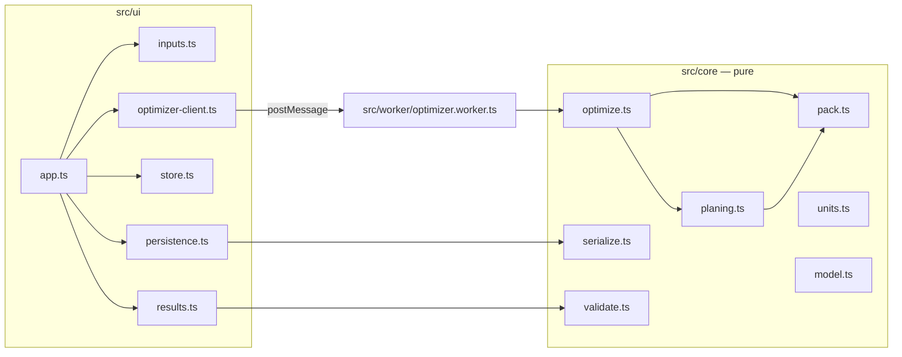

# Architecture

## Data flow

1. `Store` holds the current `Project` (immutable snapshots; `change()` clones, mutates and emits).
2. Subscribers react to each change:
   - `structure: true` rebuilds the inputs panel. Value edits don't, so focus and caret stay put.
   - a debounced optimize request goes to the worker; only the newest response is rendered.
   - a debounced save writes to localStorage.
3. `renderResults` rebuilds the results panel and runs a FLIP animation, so pieces glide to their new place.

## Modules

| Path                | Responsibility                                                           |
| ------------------- | ------------------------------------------------------------------------ |
| `core/model.ts`     | Types, factories, example project.                                       |
| `core/units.ts`     | Parse/format mm and inches. The only place unit math happens.            |
| `core/pack.ts`      | Generic 1D bin packing with kerf over several stock lengths.             |
| `core/planing.ts`   | Group parts into planing blanks.                                         |
| `core/optimize.ts`  | Per-material orchestration, statistics, unplaced reasons.                |
| `core/validate.ts`  | Non-blocking warnings, as codes (text lives in `ui/copy.ts`).            |
| `core/serialize.ts` | Schema validation, migration, JSON and share-link encoding.              |
| `ui/dom.ts`         | `h()` element builder and small helpers.                                 |
| `ui/fields.ts`      | Length/count/text inputs with live validation.                           |
| `ui/inputs.ts`      | Settings card, material cards, rows.                                     |
| `ui/results.ts`     | Summary, boards, blanks, cut lists, print header.                        |
| `ui/delight/*`      | FLIP, swipe-to-delete, sawdust, favicon spinner, sketch-mode easter egg. |
| `styles/tokens.css` | Solarized palette and design tokens (light and dark).                    |
| `styles/print.css`  | Greyscale print layout.                                                  |
| `public/sw.js`      | Offline cache.                                                           |

## Constraints

- Static hosting only (GitHub Pages, base `/cutlist/`).
- No framework. If the UI outgrows `h()` + full re-render of a panel, write an ADR before introducing one.
